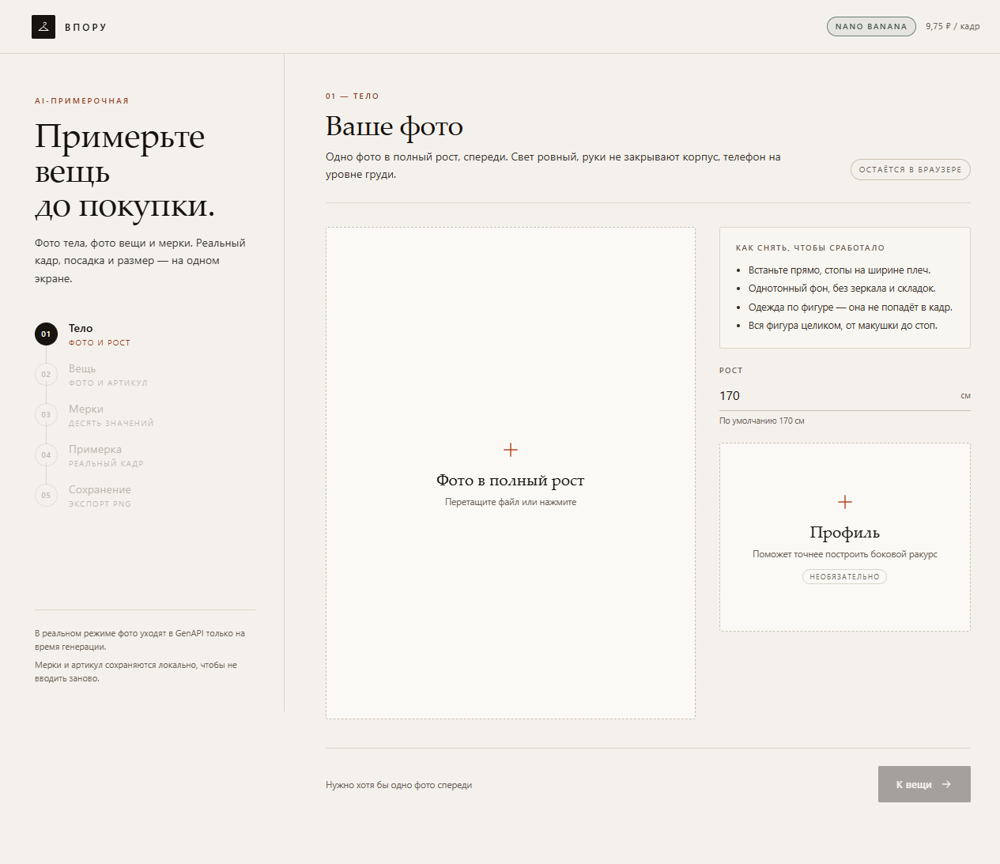
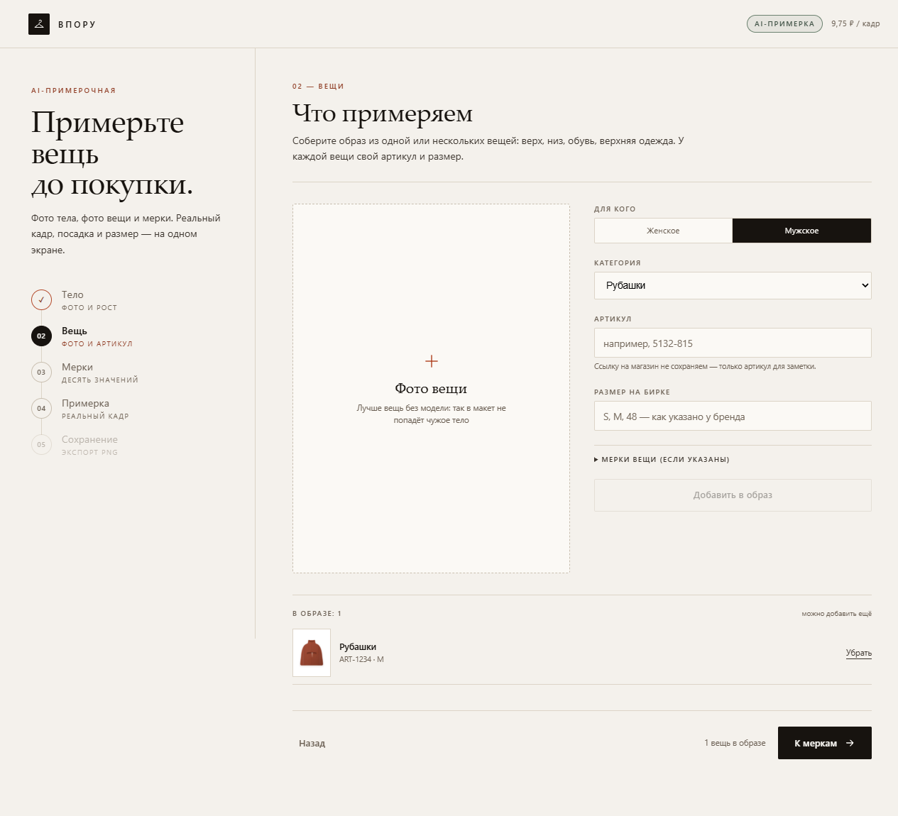
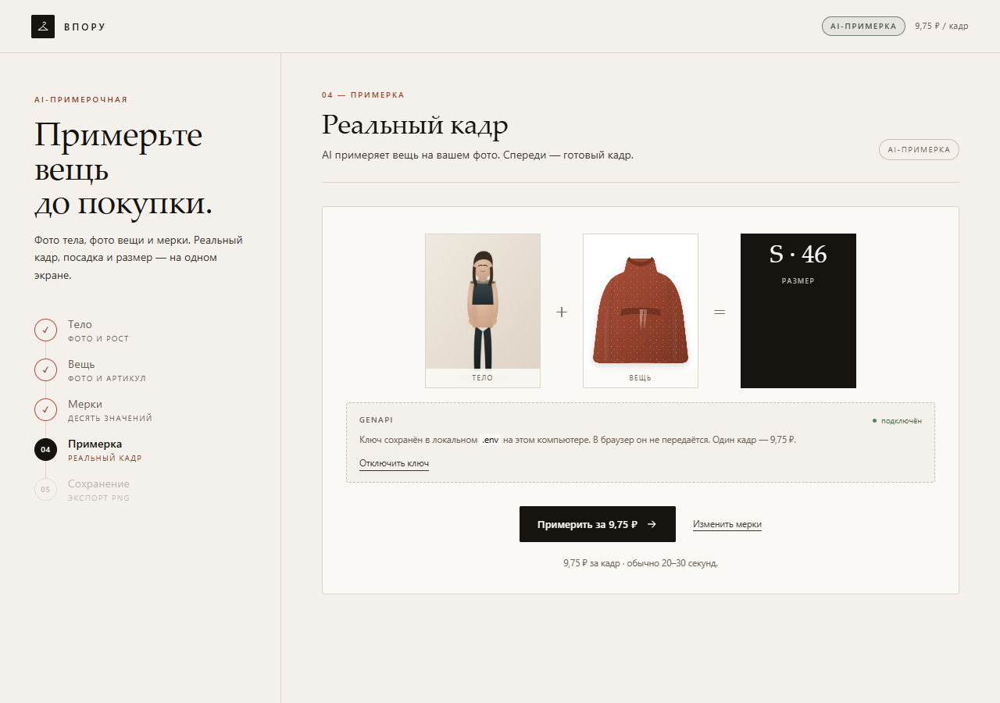
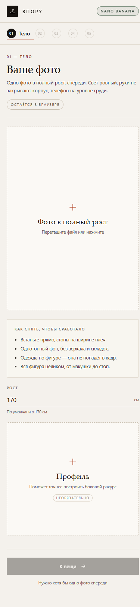

# Впору — AI-примерочная

Веб-приложение: загружаете фото и одну или несколько вещей, вводите мерки — получаете реальный кадр AI-примерка спереди (9,75 ₽), таблицу мерок, рекомендацию размера и PNG.

## Как это выглядит

| Главная | Вещи | Примерка |
| --- | --- | --- |
|  |  |  |

## Адаптив

| Экран | Что происходит |
| --- | --- |
| 1180+ | сайдбар с шагами, сцена и панель размера в две колонки |
| 1000–1180 | сайдбар уже, сцена остаётся крупной |
| 720–1000 | шапка сворачивается, загрузка и результат — в две колонки |
| до 720 | одна колонка, сцена на всю ширину, в шагах остаются номера |



На телефоне из шапки убран маркетинговый блок: остаются бренд и компактный прогресс, поэтому форма начинается сразу.

## Один режим — AI-примерка

- **9,75 ₽** за одну генерацию, обычно **20–30 секунд**;
- реальный кадр **только спереди**;
- фон и кадр — из исходного фото;
- кнопка требует **второго подтверждения** перед списанием;
- фото уходят в GenAPI только на время генерации;
- без ключа GenAPI кнопка заблокирована, на шаге примерки показывается поле для ключа.


## Каталог и образ из нескольких вещей

Каталог разделён на мужской и женский. У каждой вещи — своё фото, категория, артикул, размер на бирке и мерки.

- **Мужской:** верхняя одежда, блейзеры, пуховики, классические костюмы, комплекты, рубашки, поло, свитеры/кардиганы, футболки/лонгсливы, толстовки, брюки, джинсы, одежда для дома, обувь, сумки/рюкзаки, аксессуары, шапки.
- **Женский:** верхняя одежда, пуховики, мех, блейзеры/жилеты, платья, костюмы/комплекты, спортивные комплекты, трикотаж, топы/боди, рубашки/блузы, футболки/лонгсливы, свитеры/кардиганы, толстовки, брюки, джинсы, юбки/шорты, одежда для дома, обувь, сумки, украшения, аксессуары, шапки.

В образ можно добавить **до 6 вещей**. Реальная примерка собирает вещи в одну эталонную доску и отправляет её AI-примерка одним запросом — без доплаты за каждую вещь. Размер считается по каждой вещи отдельно: верх — по груди, низ — по талии и бёдрам.


## Демо через GitHub Codespaces

Открыть:

```text
https://codespaces.new/CZA097/VPORU
```

Codespace сам выполнит `npm install` и `npm run build`, затем запустит сервер на порту **4500**. Во вкладке **Ports** у порта 4500 выберите **Public visibility** и откройте ссылку — это и есть демо.

Важно: в Codespace нет `.env`, поэтому ключ GenAPI нужно вставить вручную на шаге «Примерка». Без ключа доступен весь интерфейс, но не генерация.

## Быстрый старт

Нужен Node.js 20.12+.

```bash
npm install
npm run dev
```

Откройте http://127.0.0.1:4400.

Продакшен:

```bash
npm run build
npm start
```

Порт меняется через `PORT`. Сервер читает `.env` (см. `.env.example`), если файл есть.

## Что уже работает

- загрузка JPG/PNG/WebP, drag & drop, проверка размера и типа файла;
- пересборка фото через canvas: EXIF и геометки не сохраняются;
- мерки с валидацией и кнопкой «подставить по росту»;
- мужской и женский каталог, образ из нескольких вещей (до 6);
- рекомендация размера по каждой вещи, женская и мужская сетка, запас на посадку;
- реальный кадр спереди AI-примерка;
- подключение своего ключа GenAPI из интерфейса с бесплатной проверкой;
- подтверждение стоимости, дневной лимит и защита от повторных кликов;
- сравнение с исходным фото, экспорт PNG 1800 × 2400;
- сохранение мерок, артикула и сетки в localStorage; фото живут только в текущей вкладке;
- адаптив 360–1440, клавиатура, `prefers-reduced-motion`.

## Подключение ключа GenAPI из интерфейса

На шаге «Примерка» есть блок **GenAPI**. Пользователь вставляет свой ключ и нажимает «Подключить»:

- ключ проверяется бесплатно запросом `GET /api/v1/request/get/{несуществующий id}`: `401` — ключ неверный, `404` — ключ принят. Генерация не запускается, деньги не списываются;
- после проверки ключ сохраняется в локальный `.env` (`GENAPI_KEY`) и в память сервера;
- в браузер ключ никогда не возвращается, в localStorage не пишется;
- кнопка «Отключить ключ» убирает его из памяти и из `.env`.

Эндпоинты: `POST /api/genapi/connect` с `{ "key": "..." }` и `POST /api/genapi/disconnect`. Оба доступны только локальному серверу, ключ не логируется.

## AI-примерка

Подключён через GenAPI. Ключ лежит в `.env` (`GENAPI_KEY`), в браузер и в клиентский бандл не попадает.

Пайплайн:

1. Сервер загружает два фото в GenAPI: `POST /api/files/upload` (multipart, поле `file`) и получает временные URL.
2. Создаёт задачу: `POST /api/v1/networks/nano-banana` с `prompt`, `image_urls` (тело, вещь), `output_format: "png"`, `aspect_ratio` по исходному фото.
3. Опрашивает `GET /api/v1/request/get/{id}` каждые 2,5 секунды до `success`.
4. Скачивает результат и отдаёт браузеру как data URL — он не зависит от временной ссылки и работает в экспорте PNG.

Цена: **9,75 ₽** за кадр, переопределяется через `GENAPI_PRICE`. Дневной лимит — `GENAPI_DAILY_LIMIT` (по умолчанию 20), параллельно — не больше двух задач. Клиент отправляет `confirm: true` только после второго нажатия кнопки.

Контракт приложения:

```http
POST /api/generate
Content-Type: application/json

{
  "provider": "genapi",
  "confirm": true,
  "jobId": "uuid",
  "category": "top",
  "size": "M",
  "measurements": { "height": 186, "chest": 93, "...": "..." },
  "items": [
    { "label": "Рубашки", "noun": "shirt", "layer": "top" },
    { "label": "Брюки", "noun": "trousers", "layer": "bottom" }
  ],
  "bodyFront": "data:image/jpeg;base64,...",
  "garment": "data:image/png;base64,...",
  "bodyWidth": 1500,
  "bodyHeight": 2000
}
```

Ответ:

```json
{
  "images": { "front": "data:image/png;base64,..." },
  "meta": { "model": "nano-banana", "ms": 19500, "cost": 9.75, "note": "..." }
}
```

Код адаптера — `server/genapi.mjs`. FASHN оставлен заглушкой: контракт тот же, при необходимости добавляется отдельным модулем.

Важно: AI-примерка делает **только фронтальный кадр**. Бок и зад не генерируются — это честно подписано в интерфейсе.

## Приватность

- До генерации фото остаются в браузере.
- При запуске примерки сервер отправляет фото в GenAPI и получает временные публичные ссылки Yandex Cloud. GenAPI хранит их ограниченное время, но это уже передача данных третьей стороне.
- Мерки и артикул хранятся в localStorage, фото — только в памяти вкладки.
- Кнопка «Начать заново» очищает сохранённые данные.
- Для продукта в РФ нужны согласие на обработку, политика конфиденциальности и основание для передачи данных. Это ответственность владельца продукта.

## Структура

```
src/
  steps/                 пять экранов: тело, вещь, мерки, примерка, сохранение
  components/
    Preview.tsx          кадр, вкладки ракурсов, сравнение
    SizeTable.tsx        размерная сетка
    ui.tsx               кнопки, поля, загрузка
  lib/
    catalog.ts           мужской и женский каталог категорий
    look.ts              образ, слои, размер по каждой вещи
    board.ts             доска вещей для AI-примерка
    measure.ts           мерки, валидация, размерные сетки
    palette.ts           доминирующий цвет и признак принта
    image.ts             чтение и нормализация фото
    export.ts            PNG из изображения провайдера
  providers/index.ts     AI-примерка
  state/store.tsx        состояние, localStorage, генерация
server/index.mjs         Express + Vite middleware, /api, статика
server/genapi.mjs        загрузка фото, задача, опрос, результат
tests/fixtures/          синтетические фото для проверки
```

## Проверки

```bash
npm run typecheck
npm run build
```

Сценарий проверен в браузере: загрузка тела и одной вещи → мерки → реальная примерка AI-примерка → скачивание PNG. Реальный кадр получен за 19,5 секунды и 9,75 ₽, экспорт — 1800 × 2400. Образ из двух вещей проверен без платного вызова: сборка доски, состав запроса и промпт. Проверены ширины 390, 768, 1024 и 1440 px: горизонтального переполнения нет, ошибок приложения в консоли нет. `prefers-reduced-motion` отключает анимации.

Подключение ключа проверено с подменой ответов: неверный ключ даёт понятную ошибку и не пишется в `.env`, верный — переключает блок в состояние «подключён». Реальный вызов GenAPI при проверке ключа не выполняется: запрашивается несуществующая генерация, ответ `401/404` стоит 0 ₽.

## Ограничения и что дальше

- Реальный режим даёт только фронтальный кадр и сохраняет фон исходного фото. Бок, зад и смена фона — следующий этап. Бесплатного демо-режима и 3D-манекена нет: каждая примерка платная.
- Несколько вещей уходят в одну доску-референс и один промпт: это дешевле, но качество зависит от модели. Для сложных образов может понадобиться повтор.
- Аксессуары, сумки, украшения и шапки перечисляются в промпте, но могут не попасть в кадр.
- Сложные позы (руки у лица, сильное перекрытие одежды) могут давать артефакты. Лучше всего работает прямой кадр в полный рост.
- Размер рекомендуется по обхватам и небольшому запасу, а не по лекалам бренда; это ориентир.
- Фото с модели на карточке товара работает хуже, чем вещь на белом фоне.
- Следующие шаги: замена фона, бок/зад, история образов, оплата и лимиты на пользователя, затем — Windows-обёртка на Tauri.
